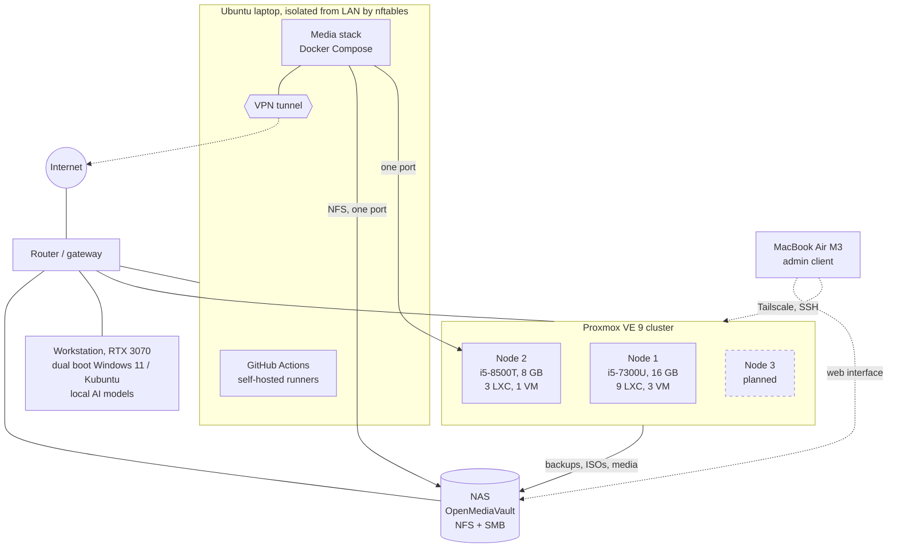

# Homelab

This is my home lab. I built it to learn Linux, virtualisation and networking hands-on, and I run and maintain it myself. It's a work in progress, so it changes as I learn new things and add hardware.

Here I write down what I run, why I set it up the way I did, and the problems I've had to solve along the way. Passwords, keys, domain names and IP addresses are left out.

Last updated: November 2026.

## Overview

## Hardware

| Machine | Hardware | What I use it for |
| --- | --- | --- |
| Proxmox node 1 | Mini PC, Intel i5-7300U, 16 GB RAM | Core services and VMs for my own projects |
| Proxmox node 2 | Mini PC, Intel i5-8500T, 8 GB RAM | Media services and a backup VM |
| Proxmox node 3 | Mini PC | Joining the cluster next |
| NAS | AMD Turion II Neo N54L, 8 GB RAM | OpenMediaVault, NFS and SMB shares |
| Laptop | Ubuntu 26.04, always on | GitHub Actions runners and Docker |
| Workstation | Ryzen 5 7600X, 32 GB RAM, RTX 3070 | Daily driver, local AI models, admin |
| MacBook Air M3 | Apple M3 | Admin laptop: Tailscale, SSH and web interfaces |

I also have two domains pointing at the lab, with DNS managed in Cloudflare.

## Proxmox cluster

Two mini PCs run as one Proxmox VE 9 cluster, so I can manage both from the same interface. A third node is on the way.

- I run services in LXC containers by default. They use little memory, which matters on small hardware, and one service per container makes each one easy to back up or move.
- I use VMs when I need a full kernel or more isolation, like test and backup machines for my own projects.
- Both nodes use the NAS as shared storage for backups, ISO images and templates.
- Backups run on a schedule with `vzdump` and are stored on the NAS.

### What runs on it

| Area | Service |
| --- | --- |
| Remote access | Tailscale |
| Reverse proxy and TLS | Nginx Proxy Manager |
| DNS filtering | AdGuard Home |
| Passwords | Vaultwarden |
| Monitoring | Uptime Kuma |
| Documentation | BookStack |
| Media | Jellyfin, Audiobookshelf |
| Utilities | Actual Budget, Stirling-PDF |
| My own projects | Test, staging and backup VMs |

Everything runs in LXC containers, except my project machines, which are VMs.

## NAS

My NAS runs OpenMediaVault and shares storage over NFS for Linux and SMB for Windows. I use it for three things: Proxmox backups, ISO images and templates, and my media library.

Downloads and the media library sit on the same share on purpose. That way a finished download is just renamed into place instead of copied.

Earlier this year a disk failed and I lost some media. Since then I check the library with a script (missing files, duplicates, odd folders) instead of trusting what the folders look like.

## CI runner laptop

An always-on Ubuntu laptop runs my self-hosted GitHub Actions runners. Runners run code from my repositories, so I treat this laptop as untrusted and keep it away from the rest of my network:

- SSH is off by default. When I turn it on for maintenance, it accepts keys only, no passwords.
- An nftables firewall blocks every connection from the laptop to my home network. It can still reach the internet and use the router for DNS.
- A systemd service loads the firewall rules at boot, and a timer checks them every minute, so they come back if something removes them.
- There are only two exceptions: one port to the NAS for NFS, and one to Jellyfin.

## Docker Compose media stack

The laptop also runs a media stack of seven containers, all defined in one Compose file. I moved it here from the cluster to free up memory on the small nodes.

Things I set up on purpose:

- **VPN kill switch.** The download client has no network of its own. It shares the VPN container's network, so if the VPN goes down, it has no connection at all.
- **Automatic port forwarding.** When the VPN gives me a forwarded port, a hook updates the download client, so I don't have to fix it by hand after a reconnect.
- **NAS as a Docker volume.** The media share is mounted over NFS from the Compose file. If the NAS is down, the containers won't start, instead of quietly filling up the laptop's disk.
- **No secrets in the file.** Passwords live in an `.env` file that isn't committed.
- **Same user everywhere.** All containers run as the same user and group that owns the NAS share, so files one app writes can be read by the others.

The Compose file: [media-stack/docker-compose.yml](media-stack/docker-compose.yml)

## Local AI models

My workstation also runs AI models locally, with no cloud services involved:

- **Windows:** ComfyUI for image generation, kohya for LoRA training, and Qwen3-TTS for speech
- **Kubuntu:** LM Studio running Qwen3-Coder to help with code

The graphics card has 8 GB of memory, and that decides which models fit.

## Troubleshooting log

I keep notes on real problems I've run into: what happened, why, how I fixed it and what I learned. You can read them in [docs/troubleshooting.md](docs/troubleshooting.md).

## What's next

- Add the third Proxmox node to the cluster
- Limit the NAS share the runner laptop can reach to media only
- Back up the media stack settings to the NAS on a schedule
- Write down my backup and restore steps, and test a full restore
