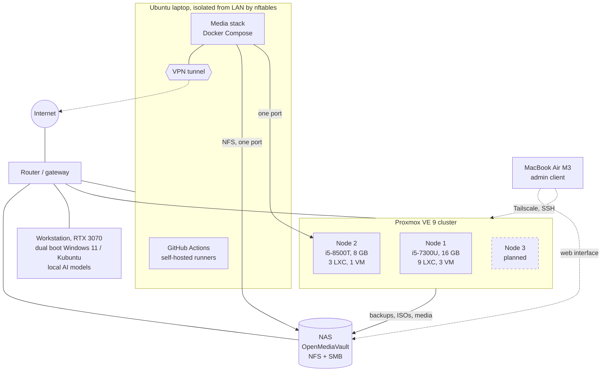

# Homelab / Infrastructure

A home lab I design, run and maintain myself: a two-node Proxmox cluster, a NAS, hardened self-hosted CI runners, a containerised media stack behind a VPN, and local AI models.

This repository documents the current state, the decisions behind it, and the problems I solved along the way. Everything is sanitised: no passwords, tokens, keys, public domain names or addresses.

Last updated: November 2026.

## Map

## Hardware

| Machine | Hardware | Role |
| --- | --- | --- |
| Proxmox node 1 | Mini PC, Intel i5-7300U, 16 GB RAM | Core services, application VMs |
| Proxmox node 2 | Mini PC, Intel i5-8500T, 8 GB RAM | Media services, backup VM |
| Proxmox node 3 | Mini PC | Planned, joins the cluster next |
| NAS | AMD Turion II Neo N54L, 8 GB RAM | OpenMediaVault, NFS and SMB |
| Laptop | Ubuntu 26.04, always on | CI runners, Docker host |
| Workstation | Ryzen 5 7600X, 32 GB RAM, RTX 3070 | Dual boot Windows 11 and Kubuntu: daily driver, local AI models, admin |
| MacBook Air M3 | Apple M3 | Admin client: Tailscale, SSH, Proxmox and NAS web interfaces |

Two public domains point at the lab. DNS is managed at Cloudflare.

## Virtualisation: Proxmox cluster

Two mini PCs form one Proxmox VE 9 cluster, managed from a single interface. A third node is being added.

- Services run in LXC containers by default: low overhead on small hardware, one service per container, easy to back up and move.
- VMs are used where a full kernel or stronger isolation is needed, for example staging and backup machines for my own software projects.
- Both nodes mount the NAS as shared storage for backups, ISO images and container templates.
- Guests are backed up to the NAS on a schedule with `vzdump`.
- Uptime at the time of writing: 85 days on node 1, 43 days on node 2.

### Services

| Area | Service | Runs as |
| --- | --- | --- |
| Remote access | Tailscale | LXC |
| Reverse proxy and TLS | Nginx Proxy Manager | LXC |
| DNS filtering | AdGuard Home | LXC |
| Secrets | Vaultwarden (password manager) | LXC |
| Monitoring | Uptime Kuma | LXC |
| Documentation | BookStack | LXC |
| Media | Jellyfin, Audiobookshelf | LXC |
| Utilities | Actual Budget, Stirling-PDF | LXC |
| Own projects | Staging, test and backup machines | VM |

## Storage: NAS

- OpenMediaVault on a low-power dual-core server, exporting shares over NFS (Linux hosts and containers) and SMB (Windows).
- Serves three purposes: Proxmox backup target, ISO and template store, and media library.
- The media share has a fixed layout: `Downloads`, `Incomplete`, `Movies`, `TV`, `Anime`. Downloads and library sit on the same share on purpose, so a finished download is moved with a rename instead of a copy across file systems.
- A disk failure earlier this year cost some media. Since then the library is audited by script (missing files, duplicates, non-standard folders) instead of trusting folder listings.

## CI runner host: hardened laptop

An always-on Ubuntu laptop hosts GitHub Actions self-hosted runners. Runners execute code from repositories, so the host is treated as untrusted towards the rest of the network:

- SSH is key-only.
- An `nftables` rule set drops every connection the host opens towards private address ranges. Only DNS to the gateway and replies to established connections are allowed.
- The rule set is loaded by a systemd unit at boot and re-checked by a timer every minute, so a removed table comes back. Without a default route it fails closed.
- Exceptions are explicit and narrow: one TCP port to the NAS (NFS) and one to Jellyfin.

## Media stack: Docker Compose

Moved from a container on the cluster to the laptop to free memory on the small nodes. Defined in one Compose file: [media-stack/docker-compose.yml](media-stack/docker-compose.yml).

| Service | Purpose |
| --- | --- |
| Gluetun | VPN client container. The download client shares its network namespace. |
| qBittorrent | Download client. Has no network path except through the VPN. |
| Prowlarr | Indexer manager, syncs to Sonarr and Radarr |
| Sonarr / Radarr | TV and movie library management |
| Bazarr | Subtitles, English and Swedish |
| Seerr | Request front end, integrated into Jellyfin |

Design decisions:

- **Kill switch by design.** qBittorrent uses `network_mode: service:gluetun`. If the VPN is down, there is no network at all.
- **Automatic port forwarding.** When the VPN provider assigns a forwarded port, Gluetun calls the qBittorrent API and sets the listening port. No manual step after a reconnect.
- **NAS as a Docker volume.** The media share is an NFS volume declared in the Compose file, not a host mount. If the NAS is unreachable, containers refuse to start instead of silently writing to the laptop disk.
- **Secrets stay out of the file.** VPN credentials come from an `.env` file with mode 600 that is not committed.
- **Size and quality limits.** 1080p only, with per-minute size caps, so the library does not fill with oversized releases.

## Local AI models

Models run locally on the workstation (Ryzen 5 7600X, 32 GB RAM, RTX 3070 8 GB), which dual boots Windows 11 and Kubuntu. Nothing here depends on a cloud API.

**On Windows:**

- ComfyUI for image generation, with an SDXL-family checkpoint.
- kohya for LoRA training.
- Qwen3-TTS (1.7B) for speech synthesis and voice design.

**On Kubuntu:**

- LM Studio serving Qwen3-Coder for local code assistance.

The 8 GB of VRAM sets the limits: SDXL-class image models and small speech models fit on the GPU, and the coding model runs quantised.

## Troubleshooting log

Real problems from building this, each with symptom, cause, fix and lesson: [docs/troubleshooting.md](docs/troubleshooting.md).

## Roadmap

- Add the third Proxmox node to the cluster.
- Limit the NAS export used by the runner host to the media share only.
- Scheduled backup of the media stack configuration to the NAS.
- Document the backup and restore procedure, including a tested restore.

## Rules for this repository

- Never commit passwords, tokens, private keys or other secrets.
- No public domain names, public IP addresses or account names.
- Configurations are examples: copy, then fill in your own values.
