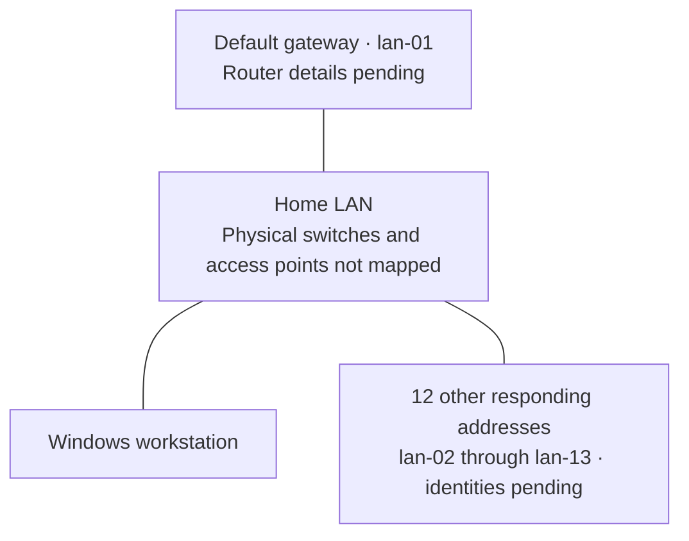
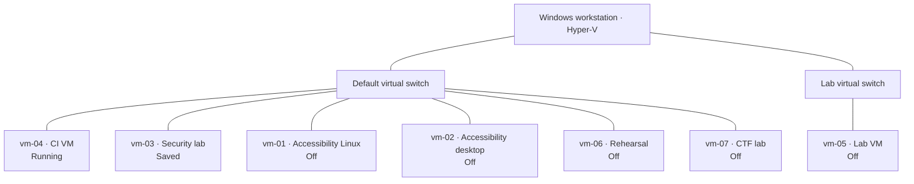
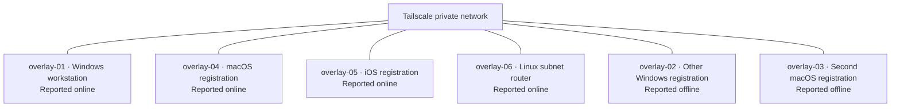

# Initial infrastructure map

Observed on 17 October 2026. Aliases below are documentation labels, not device hostnames. This map separates observed attachments from relationships that still need confirmation.

## Visual overview

These diagrams show the observed relationships. LAN lines represent membership in the same network, not known physical cabling. Tailscale lines represent private-network membership. Status is from the 17 October 2026 snapshot.

### Home network

### VMs on the Windows workstation

### Tailscale private network

The Windows workstation below is the same PC shown above. Physical locations and overlap with the other LAN endpoints remain unconfirmed.

## Home LAN

The Windows workstation is connected to the home LAN over Ethernet. Its network configuration identifies a default gateway and a preferred local DNS address. The gateway answered the ARP discovery request; the preferred local DNS address did not answer during this pass. Its absence does not prove it is offline.

The scan received ARP responses from 13 addresses: the configured gateway (`lan-01`) and 12 unclassified endpoints (`lan-02` through `lan-13`). The workstation itself is additional. ARP establishes a local address response; it does not establish a device's owner, operating system, service, physical identity, or hypervisor placement.

Individual local addresses and hardware identifiers are recorded only in the ignored local alias mapping. No physical switch, access point, or cabling arrangement has been established yet.

## Local virtualization

The Windows workstation runs Hyper-V and has these observed VM-to-switch attachments:

1. Default virtual switch: `vm-01` accessibility Linux VM, `vm-02` accessibility desktop VM, and `vm-03` security lab VM.
2. Default virtual switch: `vm-04` CI VM, `vm-06` rehearsal VM, and `vm-07` CTF VM.
3. Isolated lab virtual switch: `vm-05` lab VM.

Only `vm-04` was Running. `vm-03` was Saved. The other 5 VMs were Off. Hyper-V did not supply guest IP addresses in this snapshot. A WSL virtual interface was also present, but distributions and containers were not inventoried. A configured virtual interface alone does not prove an active workload.

## Tailscale overlay

Tailscale reports 6 registrations: `overlay-01` is the same Windows workstation; `overlay-02` is another Windows registration; `overlay-03` and `overlay-04` are macOS registrations; `overlay-05` is an iOS registration; `overlay-06` is Linux.

`overlay-01`, `overlay-04`, `overlay-05`, and `overlay-06` were reported online. The other 2 were reported offline. Two registrations share a display name; whether they represent the same physical Mac is unresolved.

The Linux peer advertises the same LAN subnet that is directly attached to the workstation. The Windows route table contains both paths. Discovery therefore used interface-specific local ARP instead of relying on the preferred routed path. No routing settings were changed. The Linux peer's physical host, local address, and virtualization placement remain unverified.

## What this map cannot yet show

It does not yet identify remote hypervisors, their guests, containers, VLANs, IPv6-only devices, sleeping devices, or hosts that do not respond to ARP. LAN and overlay identities have not been reconciled, except for the discovery workstation. No remote login, service fingerprinting, vulnerability scan, configuration change, or guest startup was performed.

## Next inventory pass

Identify the router and any Proxmox hosts with the owner. Use read-only router lease/client exports and hypervisor guest inventories to identify the LAN endpoints and connect guests to hosts. Then reconcile duplicate identities, add service roles and storage, and expand the map with evidence for each connection.
